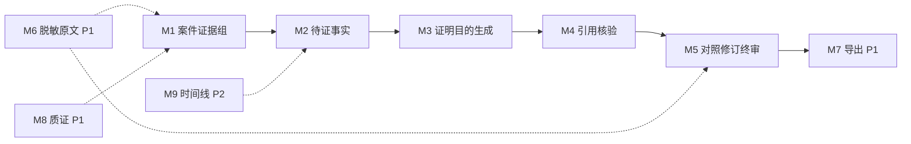

# 证目 · 产品功能清单

**产品：** 证目  
**一句话：** 诉讼律师证据目录「证明目的」高质量生成 + 法条/引用可核验 + 对照修订（律师终审）。  
**不做：** 一键可上庭文书；时间线为辅助非主打。  
**依据：** `week2-topic-and-requirements.md`、微信/深度访谈、问卷 CSV。

---

## MVP 边界（先读）

| 纳入 MVP（本周作业可演示闭环） | 明确不做 / 后置 |
|--------------------------------|-----------------|
| 建案 → 导入证据组 → 对齐待证事实 → 生成证明目的 → 引用核验 → 对照修订 → **律师确认** → 导出 | 一键起诉状/答辩状/代理词可上庭 |
| 人审终控默认开启；无出处引用标「待核」 | AI 直接改合同/直接改卷宗原文 |
| 民商事举证场景下的证明目的短句 | 全案材料自动整理当主卖点 |
| | 刑事全流程、法院内网替换 |
| | 类案策略深度引擎（P2 方向） |

**MVP 验收口径：** 用户可走完「导入→生成→核验→修订→确认→导出」闭环；律师未点确认则不可标记为定稿。

---

## 模块总览

| 模块 | 优先级 | MVP？ |
|------|--------|-------|
| M1 案件与证据组 | P0 | 是 |
| M2 待证事实对齐 | P0 | 是 |
| M3 证明目的生成 | P0 | 是 |
| M4 法条/引用可核验 | P0 | 是 |
| M5 对照修订 + 律师终审 | P0 | 是 |
| M6 脱敏与原文核对 | P1 | 部分（脱敏导入可轻量；并排原文为 P1） |
| M7 证据目录导出 | P1 | 建议 Demo 含简易导出 |
| M8 对方证据质证要点（三性） | P1 | 否 |
| M9 复杂案时间线（辅助） | P2 | 否（可关） |
| M10 录音转写入口 | P2 | 否 |
| M11 类案/策略初稿 | P2 | 否 |

---

## P0（MVP 必做）

### M1 案件与证据组

| ID | 功能点 / 用户故事 | 验收标准简述 |
|----|-------------------|--------------|
| F-P0-01 | 作为主办律师，我可以新建民商事案件并选择案由模板，以便后续证据组有上下文。 | 可创建案件；至少支持案由/备注字段；列表可打开已建案件。 |
| F-P0-02 | 作为律师/助理，我可以粘贴或导入证据清单（编号、名称、摘要），以便按证据组生成证明目的。 | 支持至少一种导入方式（粘贴表格/结构化列表）；可编辑、删除单条证据。 |
| F-P0-02b | 作为律师/助理，我可以用**手机摄像头扫描**纸质证据，快速生成证据组条目（OCR 摘要需人工核对）。 | App：调起摄像头拍照入库；网页：`capture=environment` / 相册选图；条目带「扫描」标记与缩略图；摘要标明演示 OCR。 |
| F-P0-03 | 作为律师，我可以按「证据组」批量生成，而不是对整本案卷一键乱写。 | 生成动作绑定已选证据组；未选证据组不可生成。 |

### M2 待证事实对齐

| ID | 功能点 / 用户故事 | 验收标准简述 |
|----|-------------------|--------------|
| F-P0-04 | 作为主办律师，我可以手填或轻量确认争议焦点/待证事实，再生成证明目的。 | 待证事实可编辑列表；生成前至少要求确认一次（可跳过需明示风险提示）。 |
| F-P0-05 | 作为律师，我可以看到「证据 ↔ 待证事实」对应建议，减少目录写飘。 | 每条证明目的可关联至少一项待证事实；可手动改绑。 |

### M3 证明目的生成

| ID | 功能点 / 用户故事 | 验收标准简述 |
|----|-------------------|--------------|
| F-P0-06 | 作为诉讼律师，我希望对证据组生成**短句列表**式证明目的（事实绑定、含可核对日期/金额），而不是空泛论述。 | 输出为可编辑短句条目；示范结构对齐访谈：鉴定日期、医疗费金额、诊疗必要性等事实绑定。 |
| F-P0-07 | 作为律师，我可以逐条改写、增删证明目的，降低 AI 痕迹。 | 支持行内编辑；改写后保留版本或可撤销至少一步。 |
| F-P0-08 | 作为主办律师，我可以导入客户「AI 写的」证明目的段落，进入修订流程。 | 支持粘贴外部文本作为初稿进入对照修订（见 M5）。 |

### M4 法条/引用可核验

| ID | 功能点 / 用户故事 | 验收标准简述 |
|----|-------------------|--------------|
| F-P0-09 | 作为律师，我看到的每条法条/案例引用必须带来源标识或可点开核验路径。 | 有出处：展示来源标识；无出处：标「待核」，**不得**呈现为「已确认法条」。 |
| F-P0-10 | 作为律师，我可以一键打开核验视图核对引用，而不是盲信模型输出。 | 「待核」条目可进入核对动作；已核可切换状态（人标记）。 |
| F-P0-11 | 系统不得在引用未核验时把文书状态标为「可提交」。 | 存在「待核」或未终审时，定稿/导出确认按钮受阻或强警告。 |

### M5 对照修订 + 律师终审

| ID | 功能点 / 用户故事 | 验收标准简述 |
|----|-------------------|--------------|
| F-P0-12 | 作为律师，我可以对初稿/客户稿看到对照修改建议（diff/建议点），而不是 AI 直接覆盖原文。 | 并排或行级对照；每条建议可「接受 / 改写 / 拒绝」。 |
| F-P0-13 | 作为主办律师，我必须亲自点「终审确认」后，成果才可标记为定稿。 | 确认前状态为草稿；确认写入审计记录（谁、何时）。 |
| F-P0-14 | 系统不提供「一键定稿提交法院」类入口。 | UI 无「直接提交/一键上庭」；文案强调律师担责终审。 |

---

## P1（信任与交付增强）

| ID | 模块 | 功能点 / 用户故事 | 验收标准简述 |
|----|------|-------------------|--------------|
| F-P1-01 | M6 | 导入前可一键脱敏（姓名、证件号、账号等）后再分析。 | 脱敏规则可预览；脱敏后文本可还原对照仅限授权角色（或本机会话）。 |
| F-P1-02 | M6 | 并排「原文片段 ↔ AI 结论」核对视图，隐去隐私才敢用 AI（问卷要求）。 | 选中证明目的可定位到对应证据摘要/原文片段。 |
| F-P1-03 | M7 | 导出证据目录骨架：编号、名称、证明目的段落 → Word/表格。 | 至少一种格式可下载；字段与列表一致。 |
| F-P1-04 | M7 | 导出内容可粘贴进所内既有模板，不强制换模板体系。 | 导出为段落/表格，不绑定唯一官方模板。 |
| F-P1-05 | M8 | 对方证据到达后，生成真实性/合法性/关联性「质证要点草稿」。 | 输出三性要点草稿；默认需人审；不自动写入对方「败诉结论」。 |

---

## P2（辅助与方向）

| ID | 模块 | 功能点 / 用户故事 | 验收标准简述 |
|----|------|-------------------|--------------|
| F-P2-01 | M9 | 复杂案可选时间线示意图；简单案可关闭。 | 默认关闭或按案由建议；开关不影响主流程完成。 |
| F-P2-02 | M10 | 录音转写入口（方言/嘈杂场景后置）。 | 可上传录音→文本草稿；转写结果需人工校对标记。 |
| F-P2-03 | M11 | 类案/策略初稿（高价值，依赖数据壁垒）。 | Week2 只记方向；不进 MVP Demo。 |

---

## 优先级与依赖（简图）

---

## 本周作业建议演示路径（P0 only）

1. 新建案件 → 粘贴 3～5 条证据组摘要  
2. 确认 2～3 条待证事实  
3. 生成证明目的短句列表  
4. 故意展示一条「待核」引用 + 一条可核验引用  
5. 对照修订：接受/拒绝各一条建议  
6. **律师终审确认** →（可选）导出段落  

---

## 变更记录

| 日期 | 说明 |
|------|------|
| 2026-11-21 | 初版：自 week2 P0/P1/P2 拆功能点与验收；锁定 MVP 边界 |
