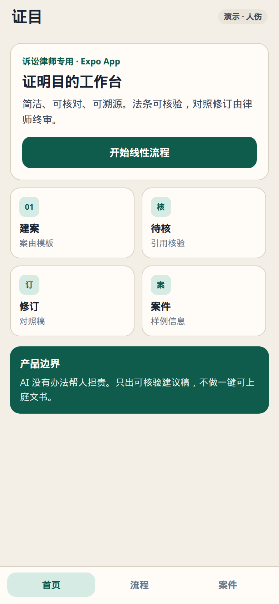
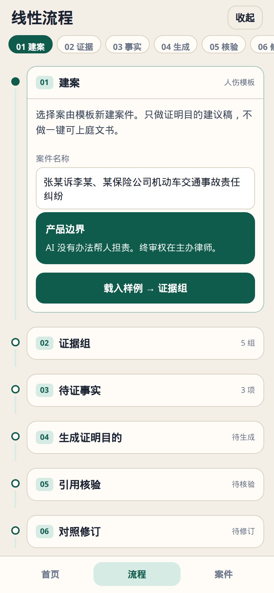
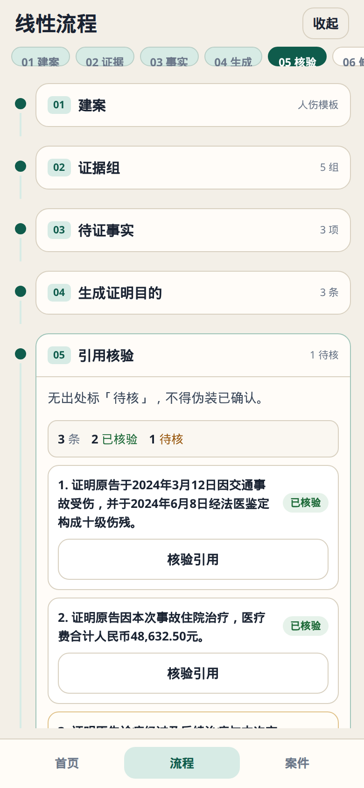
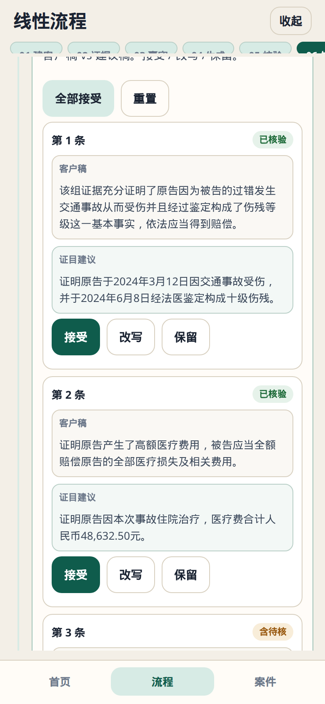
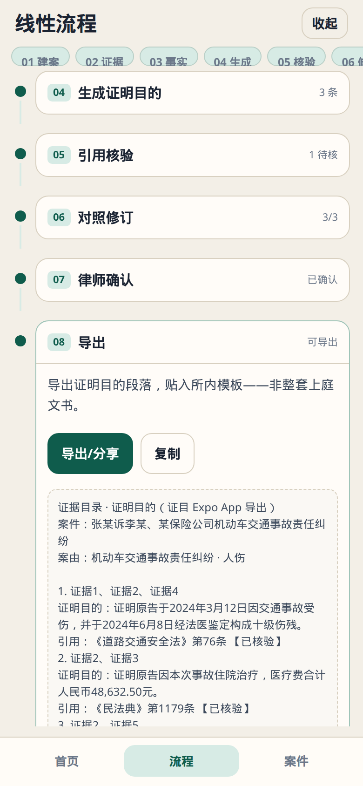

# 证目 · 原型走查（Expo 原生 App）

**主交付是 Expo / React Native App**（`zhengmu-mvp/`），不是 HTML 网页壳、不是 CSS iPhone frame。

截图来源说明：本机无 iOS/Android 模拟器时，用 **Expo Web（React Native Web）** 在移动视口下截取——与手机 Expo Go 共用同一套 `App.js` 源码。界面已标明「Expo App」。

## 如何用 Expo Go 打开

```bash
cd zhengmu-mvp
npm install
npx expo start
```

手机装 Expo Go → 扫终端 QR（同 Wi‑Fi）；或 `npx expo start --tunnel`。

## App 结构

| 屏 | 说明 |
|----|------|
| 闪屏 | 图标「证」→「打开 App」 |
| 首页 | Tab「首页」；开始线性流程 |
| 流程 | Tab「流程」；8 步线性脊线可展开 |
| 案件 | Tab「案件」；样例摘要 |

线性节点：建案 → 证据组（勾选 / **摄像头·相册·预置样例**）→ 待证事实（勾选）→ 生成 → 核验(核对原文/待核) → 修订 → 确认 → 导出定稿。

**证据导入：** 保留摄像头、相册、预置样例；扫描摘要带 **【模拟 OCR】** 标记。修改金额或更换证据后，旧律师确认失效；含待核不可导出定稿；定稿内容=确认时锁定版本。

---

## 截图

截图目录：[docs/media-prototype/](./media-prototype/)

  
`00-linear-flow.png` — Expo App 闪屏

  
`01-home.png` — 首页（标明 Expo App）

  
`02-evidence-intake.png` — 线性流程 · 建案

  
`03-purpose-result.png` — 引用核验 / 待核

  
`04-diff-revise.png` — 对照修订

  
`05-confirm-export.png` — 律师确认后导出（文案含「证目 Expo App 导出」）

产品角度不变：证明目的可核对 + 人审终控，不做一键可上庭。
