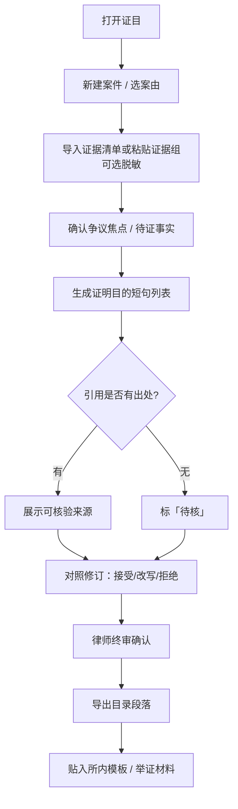

# 证目 · 需求文档（修订版 PRD）

| 字段 | 内容 |
|------|------|
| 产品名 | 证目 |
| 文档版本 | v1.1（作业可交版） |
| 日期 | 2026-11-21 |
| 状态 | 与第二周选题一致，并补全用例/非功能/指标 |
| 依据 | `docs/week2-topic-and-requirements.md`、`docs/week2-roadshow-script.md`、`internal/research/wechat-qa-insights.md`、`internal/research/xuejie-interview-transcript.md`、`internal/research/xuejie-interview.csv` |
| 配套 | `docs/product-feature-list.md`（功能点与验收） |

---

## 1. 背景与问题

诉讼律师每周真实交卷场景里，证据目录中的「证明目的」又碎又关键：要短句、绑定具体事实（日期/金额），且常需可靠法条支撑。通用 AI（豆包/DeepSeek 等）能出稿，但访谈反馈写证明目的「像一坨」、会「创制法条」、硬匹配案例；客户用 AI 扔来的材料还增加纠错成本。专业库（北大法宝/威科先行）检索可信，却不解决「把证据组写成可交的证明目的短句」；垂直法律 AI（如法天使）准确率相对更高，但存在律所账号共享摩擦。

**产品承诺：** 在证据工作流中，把证明目的写得简洁、可核对、可溯源；输出对照修订稿，**律师终审担责**。  
**明确拒绝：** 「一键出可上庭文书」——访谈金句：「AI 没有办法帮人担责。」所内「一键文书」叙事亦被否定。

**时间线：** 复杂案可用，简单案不做——**辅助能力，非主打**。

---

## 2. 目标用户与非目标

### 2.1 目标用户

| 角色 | 诉求 | 产品中的权限预期 |
|------|------|------------------|
| **主用户：民商事诉讼主办律师**（含青年律师） | 亲自把关证据目录与开庭材料；要可核验建议，不要替自己担责 | 终审确认、定稿、导出 |
| **次用户：律师助理 / 实习生** | 整理材料、出初稿 | 导入、生成、建议修订；不可跳过主办终审 |
| **间接：客户** | 常自用通用 AI 出材料 | 不作为账号主用户；其文稿可被导入纠错 |

### 2.2 非目标（MVP）

- 当事人自助出可上庭文书  
- 律所「全流程 AI 办案」平台  
- 法官/法院内网场景（问卷：法院侧基本不用外网 AI）  
- 刑事全流程、一键起诉状/答辩状

---

## 3. 使用场景

### 场景 A｜举证前编制证据目录（高频）

**前置：** 律师已梳理证据链与争议焦点（访谈：应先证据链/焦点，再编目录）。  
**动作：** 导入证据组 → 确认待证事实 → 生成证明目的短句 → 核验引用 → 对照修订 → 律师确认 → 导出贴入所内模板。  
**成功：** 证明目的短、事实可核对；引用无出处则「待核」；主办已终审。

### 场景 B｜客户「AI 写的」材料纠错

**前置：** 客户用豆包等生成证明目的/相关段落交给律师。  
**动作：** 粘贴导入 → 对照修订稿 → 改简洁、纠错引 → 律师终审。  
**成功：** 纠错成本下降；沟通可指向具体建议点而非整段重写。

### 场景 C｜收到对方证据后的质证（P1）

**前置：** 对方在举证期内提交证据。  
**动作：** 导入对方证据组 → 生成真实性/合法性/关联性要点草稿 → 人审。  
**说明：** 访谈强调核心动作是三性质证意见，而非仅更新材料库；时间线梳理可为辅助。

---

## 4. 功能需求

> 功能 ID 与验收细则见 `product-feature-list.md`。本节按需求域叙述，便于作业评审。

### 4.1 案件与证据组（P0）

- 新建/打开民商事案件；记录案由与备注。  
- 导入或粘贴证据清单（编号、名称、摘要）；支持按证据组选择后生成。  
- **手机摄像头扫描（P0 Demo）：** 调起后置摄像头拍摄纸质证据 → 生成带缩略图的证据条目 + OCR 摘要草稿（演示可 Mock，必须提示人工核对）；亦可从相册选图。  
- **约束：** 生成绑定证据组，禁止「无证据上下文的空聊生成」作为主路径。

### 4.2 待证事实 / 争议焦点对齐（P0）

- 手填或轻量建议待证事实；生成前确认。  
- 证明目的条目可关联待证事实；可改绑。  
- **流程顺序：** 对齐访谈——先焦点/证据链意识，再目录段落（产品内用「待证事实确认」落实，不假装自动替代律师归纳）。

### 4.3 证明目的生成（P0）

- 输出**短句列表**，事实绑定（日期、金额等可核对字段优先写入句中）。  
- 示范结构（交通事故/人伤类访谈示例）：鉴定日期与受伤事实；医疗费合计金额；诊疗经过与必要性。  
- 支持对客户稿/外部稿导入后进入修订，而非仅「从零生成」。

### 4.4 法条 / 引用可核验（P0）

- 每条引用：有出处 → 来源标识/核验路径；无出处 → **「待核」**，禁止伪装「已确认」。  
- 律师可人工标记已核/仍待核。  
- 存在待核或未终审时，不得将状态呈现为「可提交定稿」（强阻或强警告）。

### 4.5 对照修订 + 律师终审（P0）

- 对初稿给出 diff/建议点；接受 / 改写 / 拒绝。  
- **不让 AI 直接覆盖合同/卷宗原文**——对齐真实习惯：「只出对照修改稿，律师自己改」。  
- 主办「终审确认」后才可定稿；记录操作者与时间。  
- UI/文案禁止「一键上庭/直接提交法院」。

### 4.6 脱敏与原文核对（P1）

- 导入前脱敏客户隐私后再分析（问卷原话级要求）。  
- 并排原文片段与 AI 结论，便于放心核验。

### 4.7 导出（P1，Demo 建议含简易版）

- 导出编号、证据名称、证明目的段落为 Word/表格，贴入现有模板。

### 4.8 对方证据质证要点（P1）

- 三性（真实性、合法性、关联性）要点草稿；默认人审。

### 4.9 辅助与后置（P2）

- 复杂案时间线示意图（可关）。  
- 录音转写入口。  
- 类案/策略初稿（方向记录，不进 MVP）。

---

## 5. 主流程（用户旅程）

**路演备用口述：** 建案 → 导入证据组 → 对齐待证事实 → 生成证明目的 → 核验引用 → 对照修订 → **律师点确认** → 导出。

---

## 6. 关键用例与异常

### UC-01 生成证明目的（主路径）

| 项 | 说明 |
|----|------|
| 参与者 | 主办律师 / 助理 |
| 前置 | 案件已建；证据组非空；待证事实已确认或已明示跳过风险 |
| 主成功 | 生成短句列表；关联待证事实；进入核验与修订 |
| 异常 | 证据组为空 → 阻断并提示；模型失败 → 可重试且不丢已填字段 |

### UC-02 无出处引用

| 项 | 说明 |
|----|------|
| 触发 | 模型输出法条/案例但系统无法匹配来源 |
| 系统行为 | 标「待核」；禁止显示为已确认；定稿路径受阻或强警告 |
| 用户行为 | 人工核验后改状态，或删除该引用 |

### UC-03 客户 AI 稿纠错

| 项 | 说明 |
|----|------|
| 前置 | 粘贴外部证明目的文本 |
| 主成功 | 进入对照修订；律师终审后导出 |
| 异常 | 粘贴超长/乱码 → 分段提示；无法解析结构 → 整段作为「待修订初稿」 |

### UC-04 脱敏失败（P1）

| 项 | 说明 |
|----|------|
| 触发 | 规则未识别或用户拒绝脱敏 |
| 系统行为 | 明确告知风险；默认不进入云端分析（或仅本地），需用户二次确认 |

### UC-05 未终审导出

| 项 | 说明 |
|----|------|
| 触发 | 用户尝试导出定稿 |
| 系统行为 | 若未终审：仅允许「草稿导出」水印/标记，或阻断「定稿导出」 |

---

## 7. 非功能需求

### 7.1 隐私与脱敏

- 默认引导：隐去客户隐私后再分析（对齐问卷）。  
- 涉密/纸质为主的材料：产品不鼓励「整卷无脱敏上传」；支持摘要粘贴降低暴露面。  
- 不将用户案卷默认用于模型训练（产品原则声明；实现侧随部署方案落实）。

### 7.2 人审与责任边界

- 人审终控**默认开启、不可关闭为「AI 自动定稿」**。  
- 文案与空状态明确：输出为建议，律师核验即可；AI 不替人担责。  
- 终审操作可追溯（操作者、时间、对象版本）。

### 7.3 可信输出

- 引用无出处不得伪装已确认。  
- 不承诺零幻觉；承诺「可核验工作流」。

### 7.4 体验与协作（相对竞品缝隙）

- 避免「律所一账号抢登被踢」类强摩擦：MVP 至少支持个人登录流畅使用；多席位为后续。  
- 主流程步骤清晰，避免做成又一个无约束聊天框。

### 7.5 性能与可用性（作业级）

- 单次证据组（≤20 条摘要）生成应在可接受交互时间内完成或显示进度。  
- 关键操作可撤销至少一步（编辑证明目的）。

---

## 8. 范围外（Out of Scope）

| 不做 | 原因（访谈/产品锁） |
|------|---------------------|
| 一键可上庭起诉状/答辩状/代理词 | 结构易错、责任面大；路演叙事被否定 |
| AI 直接改合同/直接覆盖卷宗 | 真实工作流只要对照稿 |
| 全案材料自动整理当主卖点 | 通用模型可做、价值浅、可能加核验工作量 |
| 法院内网替换 | 问卷：法院基本不用外网 AI |
| 刑事全流程 | MVP 聚焦民商事举证 |
| 以时间线为主打卖点 | 辅助非主打 |
| 承诺零幻觉、替代律师判断 | 「AI 没有办法帮人担责」 |

---

## 9. 成功指标

| 类型 | 指标 | 说明 |
|------|------|------|
| 作业/Demo | 主路径闭环可演示 | 导入→生成→待核/已核→对照修订→终审→导出 |
| 质量代理 | 证明目的「短句率 / 含具体事实字段占比」 | 相对通用 AI 空泛论述更可核对 |
| 可信代理 | 「待核」未伪装率 = 100% | 产品规则硬约束 |
| 人审 | 定稿前终审完成率 | 未确认不得称定稿 |
| 调研验证 | 律师愿用「核验建议」而非「代写上庭」 | 对齐金句：律师只要核验即可 |
| 后续（有样本后） | 相对从零撰写，修订耗时下降 | 需小样本对照实验，本周不编造数据 |

---

## 10. 与第二周文档一致性说明

| week2 锁定项 | 本文落实 |
|--------------|----------|
| 窄而深：证明目的 | §1、§4.3 |
| 可核验引用 | §4.4、UC-02 |
| 对照修订 + 人审 | §4.5、§7.2 |
| 时间线辅助非主打 | §4.9、§8 |
| 不做一键上庭 | §8、UC-05 |
| P0/P1/P2 | §4 与功能清单对齐 |

---

## 11. 开放问题（不阻断本周交付）

1. 法条核验第一期接公开库/自建索引，还是仅「来源字段 + 人工核」占位？  
2. 多席位协作与所内账号策略（对标法天使摩擦）排期。  
3. 纸质卷宗 OCR 是否进 P1 或保持「摘要粘贴」降低隐私风险。

---

## 变更记录

| 版本 | 日期 | 说明 |
|------|------|------|
| v1.0 | 2026-11（week2） | 选题与需求范围 |
| v1.1 | 2026-11-21 | 正式 PRD：用例、非功能、范围外、成功指标；对齐功能清单 |
